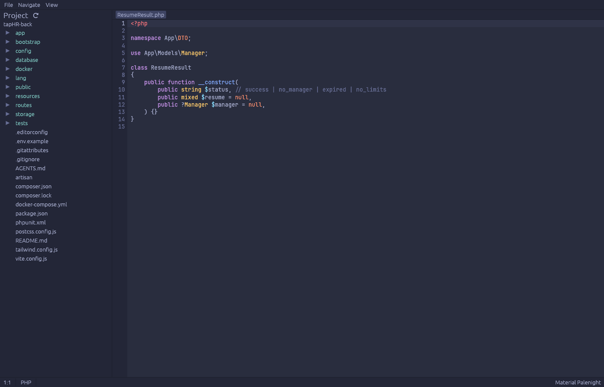
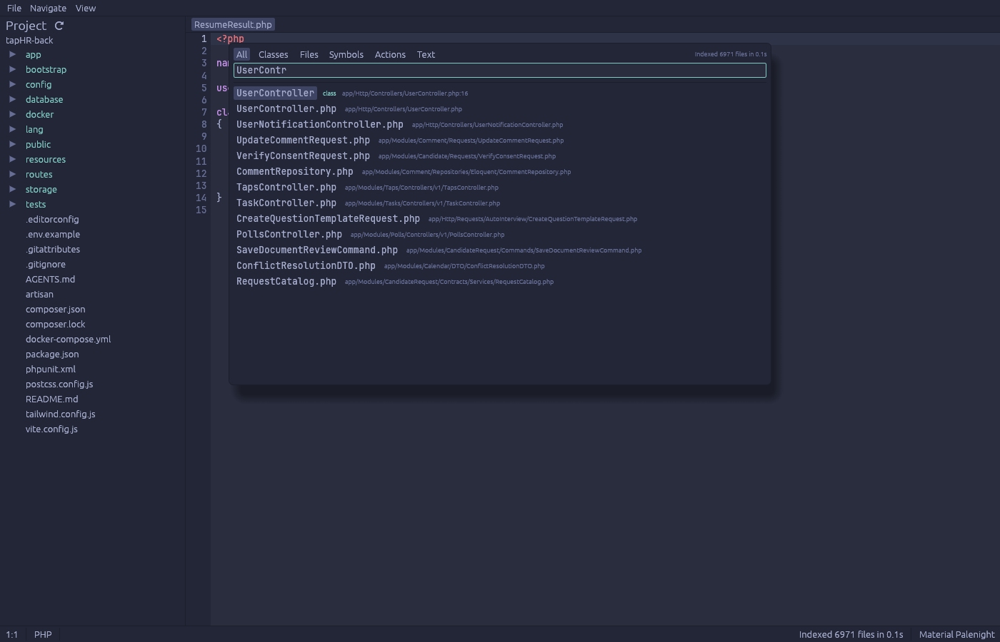
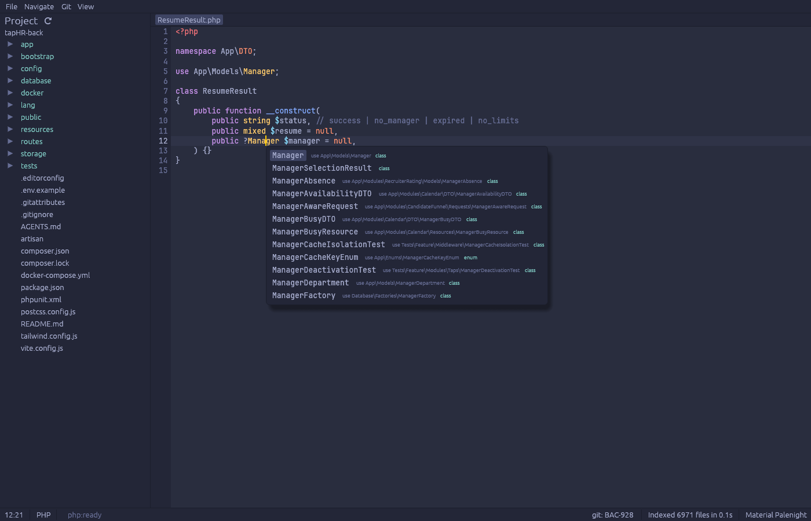
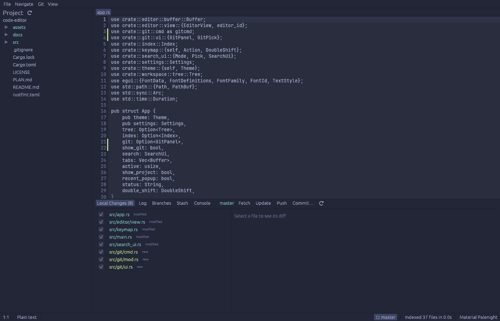
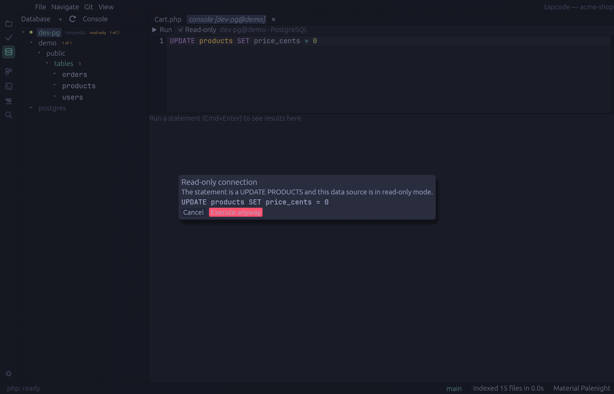
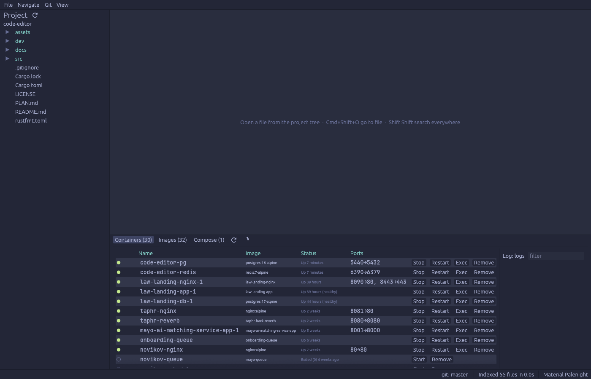

# code-editor

Opensource IDE на Rust для PHP / JavaScript / TypeScript в духе JetBrains: редактор с tree-sitter-подсветкой, Git, базы данных с read-only режимом, Docker, встроенный терминал и LSP. GUI на `egui`, без webview.



## Что умеет

| Область | Возможности |
|---|---|
| Редактор | Подсветка PHP, JS/JSX, TS/TSX, JSON, HTML, CSS, Markdown, YAML, SQL (tree-sitter); undo/redo, мультистрочные операции, find/replace (Cmd+F / Cmd+R), автоотступ, комментарии (Cmd+/), автосохранение через 1 с и при потере фокуса |
| Навигация | Search Everywhere (Shift Shift), Go to File (Cmd+Shift+O), Class (Cmd+O), Symbol (Cmd+Alt+O), Find in Path (Cmd+Shift+F), Replace in Path (Cmd+Shift+R), Find Action (Cmd+Shift+A), Recent Files (Cmd+E) |
| Индекс | SQLite в `.code-editor/index.db`: файлы, полнотекстовый FTS5 (trigram), символы; инкрементальное обновление по событиям ФС |
| Code intelligence | LSP-клиент: intelephense (PHP), typescript-language-server (JS/TS) — автодополнение, hover, Cmd+B / Cmd+click, диагностика |
| Git (Cmd+9) | Local Changes с diff, stage/unstage/rollback, commit (Cmd+K), push (Cmd+Shift+K), pull (Cmd+T), fetch, log с cherry-pick/revert/reset, branches (create/checkout/merge/rebase/delete), stash, blame, маркеры изменений в gutter |
| Database (Cmd+5) | PostgreSQL и Redis; read-only как в JetBrains: серверный `default_transaction_read_only` + классификация SQL/команд с диалогом «Execute anyway»; обзор схемы/ключей, SQL-консоль (Cmd+Enter), пароли в macOS Keychain |
| Services (Cmd+8) | Docker: контейнеры (start/stop/restart/remove, логи, exec в терминал), образы (pull/remove), docker compose up/down/ps/logs |
| Терминал (Alt+F12) | PTY + alacritty_terminal, несколько вкладок, 256/true color |
| Темы | Material Palenight (по умолчанию), Oceanic, Darker, Lighter — переключаются в View / Settings (Cmd+,) |







## Сборка и запуск

Требования: Rust stable (`rustup`), git; для LSP — node (серверы запускаются через `npx` автоматически); для Docker-панели — Docker Desktop.

```bash
cargo run --release -- ~/path/to/project
```

`.app`-бандл:

```bash
sh dev/bundle.sh && open target/code-editor.app
```

Локальные Postgres и Redis для пробы панели Database:

```bash
docker compose -f dev/docker-compose.yml up -d
```

(порт 5440, пользователь `postgres`, пароль `devpass`, база `demo`; Redis на 6390).

## Настройки

`~/Library/Application Support/code-editor/settings.toml` — тема, размер шрифта, автосохранение, команды LSP-серверов, список соединений с БД (без паролей). Редактируется через Cmd+,.

## Переменные для скриншотов и smoke-проверок

- `CODE_EDITOR_SCREENSHOT=out.png` — снять окно через `CODE_EDITOR_SCREENSHOT_DELAY` секунд (по умолчанию 1.5) и выйти.
- `CODE_EDITOR_DEMO=…` — открыть при старте: `all:<query>` / `files:` / `classes:` / `text:` (поиск), `git:` / `git:commit`, `terminal:`, `docker:`, `lsp:<line>:<col>` (автодополнение), `db:<name>:<password>:<statement>`.

## Структура

```
src/
  app.rs            корневой egui::App, раскладка панелей, действия
  keymap.rs         JetBrains-хоткеи → Action
  theme.rs          Material-темы (assets/themes/*.toml)
  editor/           буфер (ropey), подсветка (tree-sitter), виджет редактора
  index/            SQLite-индекс, индексатор, fuzzy-поиск, символы
  search_ui.rs      попап Search Everywhere / Go to … / Find in Path
  lsp/              JSON-RPC клиент и менеджер серверов
  git/              обёртка над git CLI + панель
  db/               Postgres/Redis воркеры, read-only guard, keychain, панель
  docker/           bollard + compose CLI, панель Services
  terminal/         PTY-сессии и рендер терминала
```

Лицензия: MIT.
